# HW4 — SELECT + JOIN

Всего: **36 запросов** — 26 запросов по разделу `SELECT` и 10 запросов по разделу `JOIN`.

---

# 1. SELECT

## 1.1. Выборка всех данных из таблицы

### Запрос 1

Вывести все данные из таблицы `product`.

```sql
SELECT *
FROM product;
```

**Скриншот результата:**

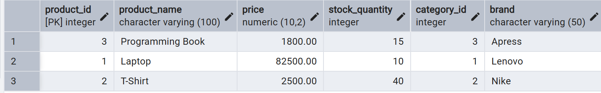

### Запрос 2

Вывести все данные из таблицы `client`.

```sql
SELECT *
FROM client;
```

**Скриншот результата:**

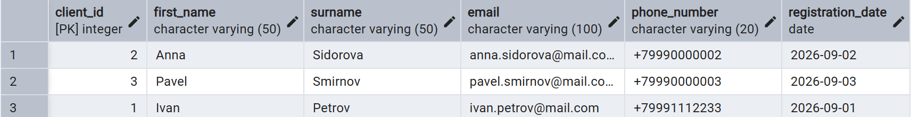

## 1.2. Выборка отдельных столбцов

### Запрос 3

Вывести название, цену и количество товара на складе.

```sql
SELECT product_name, price, stock_quantity
FROM product;
```

**Скриншот результата:**

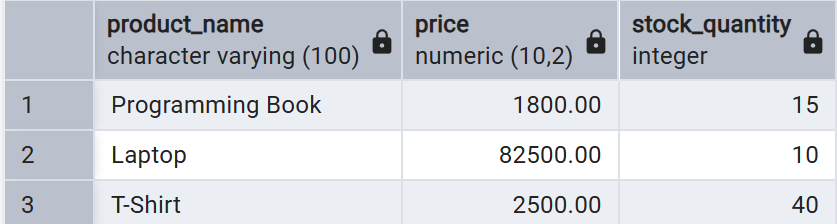

### Запрос 4

Вывести имя, фамилию и электронную почту клиентов.

```sql
SELECT first_name, surname, email
FROM client;
```

**Скриншот результата:**

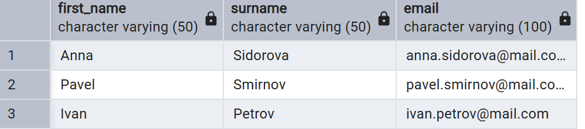

## 1.3. Присвоение новых имён столбцам

### Запрос 5

Переименовать столбцы товара в результирующей выборке.

```sql
SELECT
    product_name AS название_товара,
    price AS цена,
    stock_quantity AS остаток_на_складе
FROM product;
```

**Скриншот результата:**

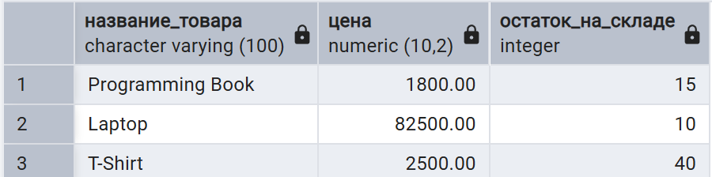


### Запрос 6

Вывести данные клиентов с понятными именами столбцов.

```sql
SELECT
    first_name AS имя,
    surname AS фамилия,
    registration_date AS дата_регистрации
FROM client;
```

**Скриншот результата:**

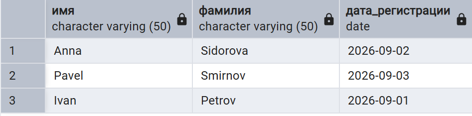

## 1.4. Выборка с вычисляемым столбцом

### Запрос 7

Рассчитать стоимость всего остатка каждого товара.

```sql
SELECT
    product_name,
    price,
    stock_quantity,
    ROUND(price * stock_quantity, 2) AS stock_total
FROM product;
```

**Скриншот результата:**

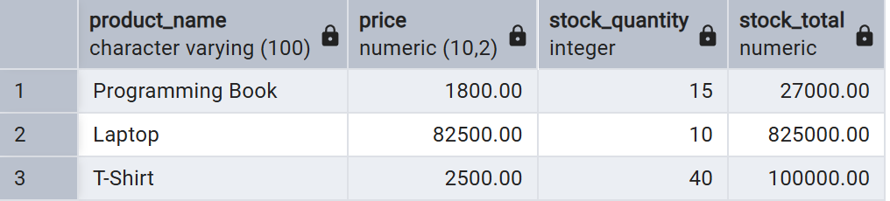

### Запрос 8

Рассчитать стоимость каждой позиции заказа.

```sql
SELECT
    order_id,
    product_id,
    quantity,
    ROUND(quantity * (
        SELECT p.price
        FROM product AS p
        WHERE p.product_id = op.product_id
    ), 2) AS item_total
FROM order_product AS op;
```

**Скриншот результата:**

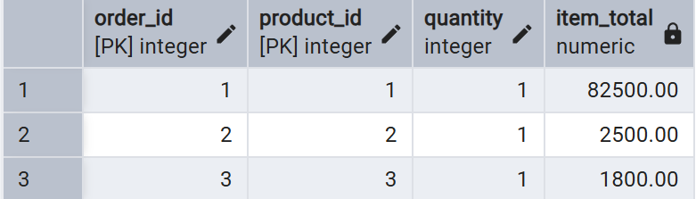

## 1.5. Вычисляемые столбцы и математические функции

### Запрос 9

Округлить цену товара до целого значения и вычислить цену со скидкой 10%.

```sql
SELECT
    product_name,
    price,
    ROUND(price) AS rounded_price,
    ROUND(price * 0.90, 2) AS price_after_discount
FROM product;
```

**Скриншот результата:**

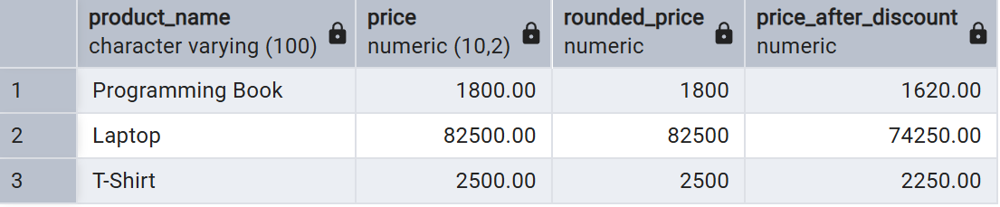

### Запрос 10

Рассчитать сумму заказа с условной комиссией 3% и округлить результат.

```sql
SELECT
    order_id,
    order_total,
    ROUND(order_total * 1.03, 2) AS total_with_commission,
    CEIL(order_total) AS rounded_up_total
FROM orders;
```

**Скриншот результата:**

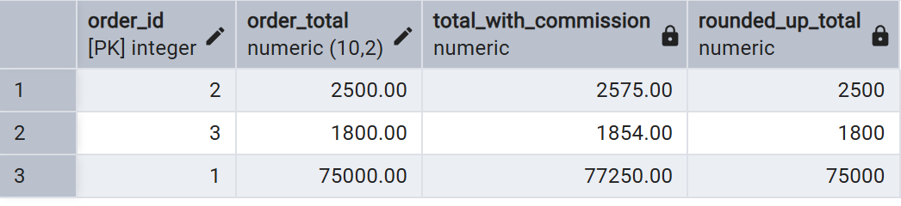

## 1.6. Выборка с логическими функциями (`CASE`)

### Запрос 11

Определить состояние запаса товара.

```sql
SELECT
    product_name,
    stock_quantity,
    CASE
        WHEN stock_quantity = 0 THEN 'Нет на складе'
        WHEN stock_quantity < 10 THEN 'Мало'
        ELSE 'Достаточно'
    END AS stock_status
FROM product;
```

**Скриншот результата:**

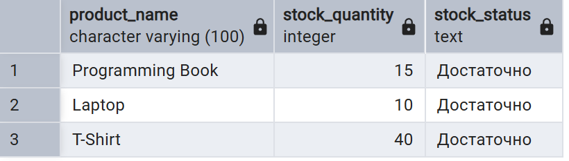

### Запрос 12

Определить категорию заказа по его сумме.

```sql
SELECT
    order_id,
    order_total,
    CASE
        WHEN order_total < 1000 THEN 'Небольшой заказ'
        WHEN order_total < 5000 THEN 'Средний заказ'
        ELSE 'Крупный заказ'
    END AS order_category
FROM orders;
```

**Скриншот результата:**

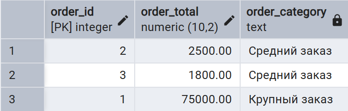

## 1.7. Выборка данных по условию (`WHERE`)

### Запрос 13

Вывести товары дешевле 1000.

```sql
SELECT product_name, price
FROM product
WHERE price < 5000;
```

**Скриншот результата:**

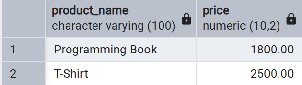

### Запрос 14

Вывести заказы со статусом `completed`.

```sql
SELECT order_id, order_date, order_total, status
FROM orders
WHERE status = 'completed';
```

**Скриншот результата:**


## 1.8. Выборка с логическими операциями (`AND`, `OR`, `NOT`)

### Запрос 15

Вывести недорогие товары с небольшим остатком.

```sql
SELECT product_name, price, stock_quantity
FROM product
WHERE price < 2000
  AND stock_quantity < 20;
```

**Скриншот результата:**

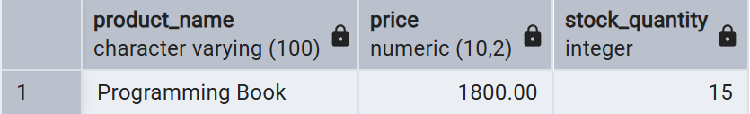

### Запрос 16

Вывести заказы со статусом `new` или `processing`, но только стоимостью больше 1000.

```sql
SELECT order_id, status, order_total
FROM orders
WHERE (status = 'paid' OR status = 'delivered')
  AND order_total > 1000;
```

**Скриншот результата:**

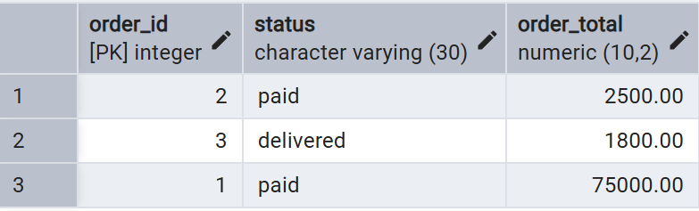

## 1.9. Операторы `BETWEEN` и `IN`

### Запрос 17

Вывести товары с ценой от 500 до 3000 включительно.

```sql
SELECT product_name, price
FROM product
WHERE price BETWEEN 500 AND 3000;
```

**Скриншот результата:**

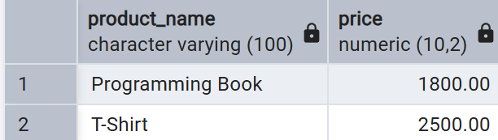

### Запрос 18

Вывести заказы, которые относятся к указанным статусам.

```sql
SELECT order_id, status, order_total
FROM orders
WHERE status IN ('paid', 'delivered');
```

**Скриншот результата:**

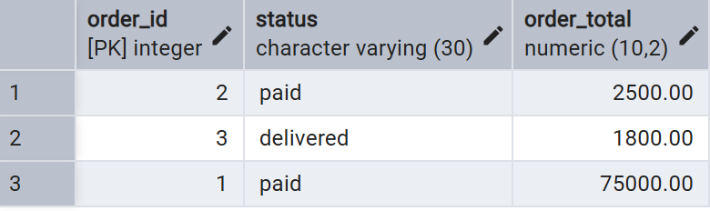

## 1.10. Выборка с сортировкой (`ORDER BY`)

### Запрос 19

Отсортировать товары по цене от большей к меньшей.

```sql
SELECT product_name, price, stock_quantity
FROM product
ORDER BY price DESC;
```

**Скриншот результата:**

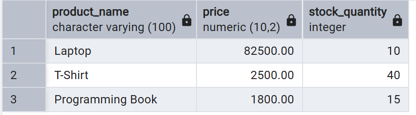

### Запрос 20

Отсортировать заказы сначала по статусу, затем по сумме от большей к меньшей.

```sql
SELECT order_id, status, order_total, order_date
FROM orders
ORDER BY status ASC, order_total DESC;
```

**Скриншот результата:**

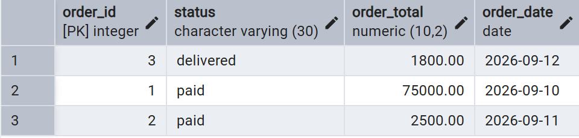

## 1.11. Выборка с оператором `LIKE`

### Запрос 21

Вывести товары, название которых начинается с буквы `A`.

```sql
SELECT product_name
FROM product
WHERE product_name LIKE 'L%';
```

**Скриншот результата:**

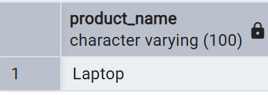

### Запрос 22

Вывести товары, в названии которых встречается слово или фрагмент `phone`.

```sql
SELECT product_name
FROM product
WHERE product_name LIKE '%Shirt%';
```

**Скриншот результата:**

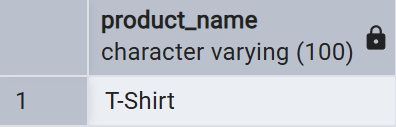

## 1.12. Выбор уникальных значений (`DISTINCT`)

### Запрос 23

Вывести уникальные бренды товаров.

```sql
SELECT DISTINCT brand
FROM product
WHERE brand IS NOT NULL
ORDER BY brand;
```

**Скриншот результата:**

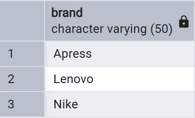

### Запрос 24

Вывести уникальные статусы заказов.

```sql
SELECT DISTINCT status
FROM orders
WHERE status IS NOT NULL
ORDER BY status;
```

**Скриншот результата:**

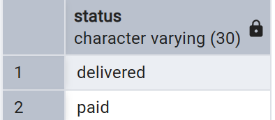

## 1.13. Ограничение количества строк (`LIMIT`, `OFFSET`)

### Запрос 25

Вывести пять самых дорогих товаров.

```sql
SELECT product_name, price
FROM product
ORDER BY price DESC
LIMIT 5;
```

**Скриншот результата:**

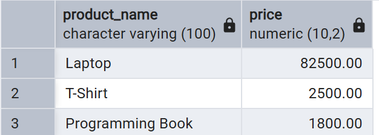

### Запрос 26

Вывести вторую страницу товаров: пропустить первый и вывести следующие два.

```sql
SELECT product_id, product_name, price
FROM product
ORDER BY product_id
LIMIT 2 OFFSET 1;
```

**Скриншот результата:**

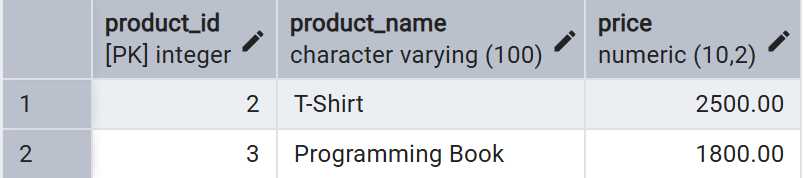

---

# 2. JOIN

## 2.1. `INNER JOIN`

### Запрос 27

Вывести заказы вместе с именами и фамилиями клиентов.

```sql
SELECT
    o.order_id,
    o.order_date,
    o.status,
    o.order_total,
    c.first_name,
    c.surname
FROM orders AS o
INNER JOIN client AS c
    ON c.client_id = o.client_id;
```

**Скриншот результата:**

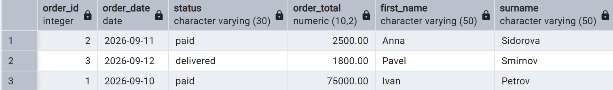

### Запрос 28

Вывести состав заказов: товар, количество и цену.

```sql
SELECT
    op.order_id,
    p.product_name,
    op.quantity,
    p.price,
    ROUND(op.quantity * p.price, 2) AS item_total
FROM order_product AS op
INNER JOIN product AS p
    ON p.product_id = op.product_id;
```

**Скриншот результата:**

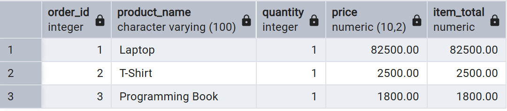

## 2.2. `LEFT JOIN`

### Запрос 29

Вывести всех клиентов, включая клиентов без заказов.

```sql
SELECT
    c.client_id,
    c.first_name,
    c.surname,
    o.order_id,
    o.order_date,
    o.order_total
FROM client AS c
LEFT JOIN orders AS o
    ON o.client_id = c.client_id
ORDER BY c.client_id;
```

**Скриншот результата:**

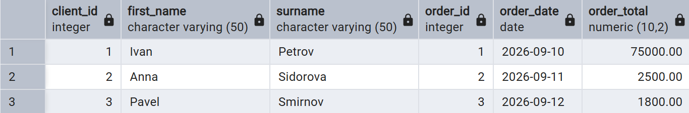

### Запрос 30

Вывести все товары, включая товары, которые ещё не входят ни в один заказ.

```sql
SELECT
    p.product_id,
    p.product_name,
    p.price,
    op.order_id,
    op.quantity
FROM product AS p
LEFT JOIN order_product AS op
    ON op.product_id = p.product_id
ORDER BY p.product_id;
```

**Скриншот результата:**

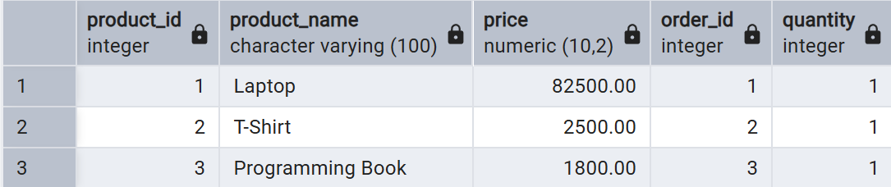

## 2.3. `RIGHT JOIN`

### Запрос 31

Вывести все заказы, включая заказы, для которых клиент не найден.

```sql
SELECT
    c.client_id,
    c.first_name,
    c.surname,
    o.order_id,
    o.order_date,
    o.order_total
FROM client AS c
RIGHT JOIN orders AS o
    ON o.client_id = c.client_id
ORDER BY o.order_id;
```

**Скриншот результата:**

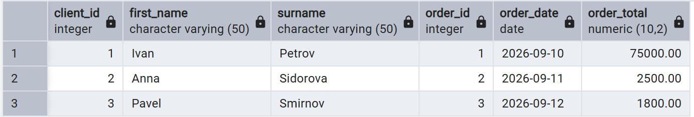

### Запрос 32

Вывести все платежи, включая платежи без соответствующего заказа.

```sql
SELECT
    o.order_id,
    o.order_date,
    p.payment_id,
    p.payment_date,
    p.payment_amount,
    p.payment_status
FROM orders AS o
RIGHT JOIN payment AS p
    ON p.order_id = o.order_id
ORDER BY p.payment_id;
```

**Скриншот результата:**

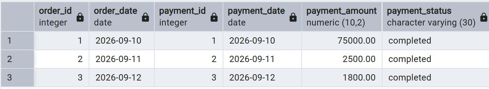

## 2.4. `CROSS JOIN`

### Запрос 33

Получить все возможные пары «клиент — категория товара».

```sql
SELECT
    c.client_id,
    c.first_name,
    c.surname,
    cat.category_id,
    cat.category_name
FROM client AS c
CROSS JOIN category AS cat
LIMIT 50;
```

**Скриншот результата:**

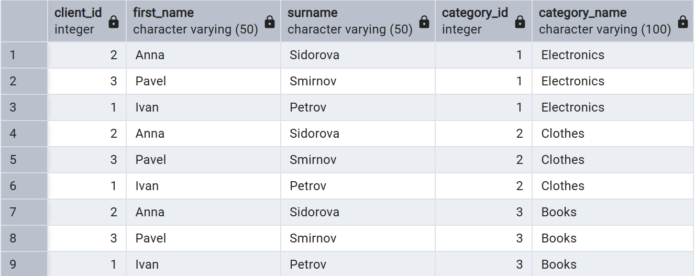

### Запрос 34

Получить все возможные пары «категория — способ оплаты».

```sql
SELECT
    cat.category_name,
    methods.payment_method
FROM category AS cat
CROSS JOIN (
    VALUES
        ('card'),
        ('cash'),
        ('online')
) AS methods(payment_method)
LIMIT 50;
```

**Скриншот результата:**

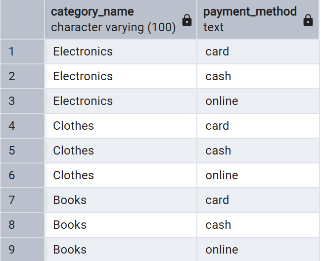

## 2.5. `FULL OUTER JOIN` — полное внешнее соединение

### Запрос 35

Вывести все заказы и все платежи, даже если для записи с одной стороны нет пары.

```sql
SELECT
    o.order_id,
    o.order_date,
    o.order_total,
    p.payment_id,
    p.payment_date,
    p.payment_amount,
    p.payment_status
FROM orders AS o
FULL OUTER JOIN payment AS p
    ON p.order_id = o.order_id
ORDER BY COALESCE(o.order_id, p.order_id);
```

**Скриншот результата:**

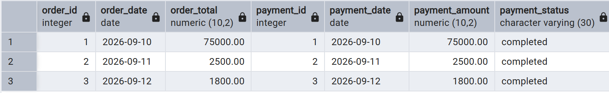

### Запрос 36

Вывести все товары и все категории, включая товары без категории и категории без товаров.

```sql
SELECT
    p.product_id,
    p.product_name,
    p.category_id AS product_category_id,
    c.category_id,
    c.category_name
FROM product AS p
FULL OUTER JOIN category AS c
    ON c.category_id = p.category_id
ORDER BY COALESCE(p.category_id, c.category_id), p.product_id;
```

**Скриншот результата:**


