# Домашняя работа: агрегатные функции, GROUP BY и расширенные группировки

## 1. COUNT()

### Запрос 1. Количество товаров в каждой категории

```sql
SELECT
    c.category_name,
    COUNT(p.product_id) AS product_count
FROM category AS c
LEFT JOIN product AS p
    ON p.category_id = c.category_id
GROUP BY c.category_id, c.category_name
ORDER BY product_count DESC, c.category_name;
```

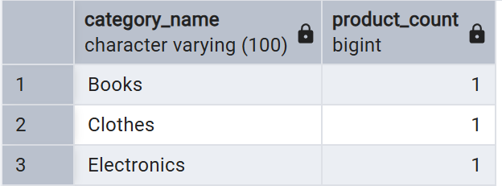

### Запрос 2. Количество заказов у каждого клиента

```sql
SELECT
    cl.client_id,
    cl.first_name,
    cl.surname,
    COUNT(o.order_id) AS order_count
FROM client AS cl
LEFT JOIN orders AS o
    ON o.client_id = cl.client_id
GROUP BY cl.client_id, cl.first_name, cl.surname
ORDER BY order_count DESC, cl.surname, cl.first_name;
```

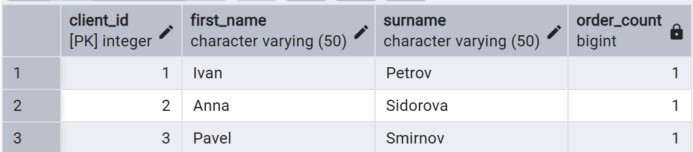

---

## 2. SUM()

### Запрос 1. Общая сумма всех заказов по статусам

```sql
SELECT
    status,
    SUM(order_total) AS total_amount
FROM orders
GROUP BY status
ORDER BY total_amount DESC;
```

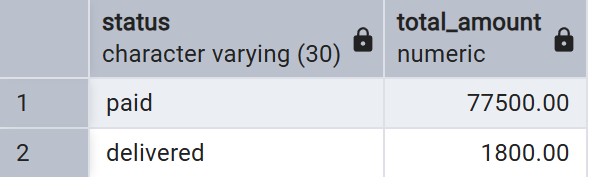

### Запрос 2. Общая сумма платежей по способам оплаты

```sql
SELECT
    payment_method,
    SUM(payment_amount) AS total_paid
FROM payment
GROUP BY payment_method
ORDER BY total_paid DESC;
```

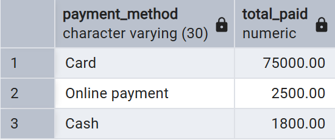

---

## 3. AVG()

### Запрос 1. Средняя цена товаров по категориям

```sql
SELECT
    c.category_name,
    ROUND(AVG(p.price), 2) AS average_price
FROM category AS c
JOIN product AS p
    ON p.category_id = c.category_id
GROUP BY c.category_id, c.category_name
ORDER BY average_price DESC;
```

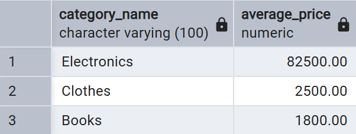

### Запрос 2. Средняя сумма заказа по статусам

```sql
SELECT
    status,
    ROUND(AVG(order_total), 2) AS average_order_total
FROM orders
GROUP BY status
ORDER BY average_order_total DESC;
```

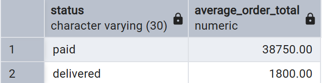

---

## 4. MIN()

### Запрос 1. Самая низкая цена товара в каждой категории

```sql
SELECT
    c.category_name,
    MIN(p.price) AS minimum_price
FROM category AS c
JOIN product AS p
    ON p.category_id = c.category_id
GROUP BY c.category_id, c.category_name
ORDER BY minimum_price, c.category_name;
```

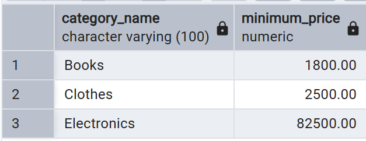

### Запрос 2. Самый ранний заказ каждого клиента

```sql
SELECT
    cl.client_id,
    cl.first_name,
    cl.surname,
    MIN(o.order_date) AS first_order_date
FROM client AS cl
JOIN orders AS o
    ON o.client_id = cl.client_id
GROUP BY cl.client_id, cl.first_name, cl.surname
ORDER BY first_order_date, cl.surname, cl.first_name;
```

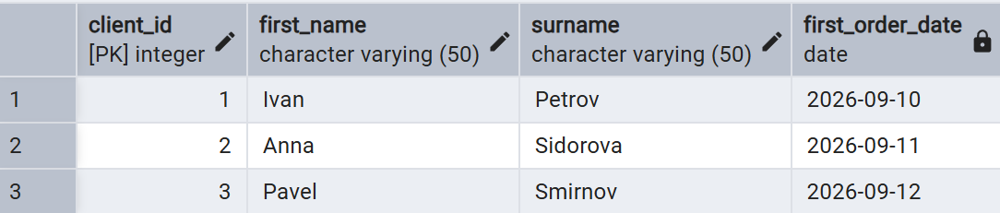

---

## 5. MAX()

### Запрос 1. Самая высокая цена товара в каждой категории

```sql
SELECT
    c.category_name,
    MAX(p.price) AS maximum_price
FROM category AS c
JOIN product AS p
    ON p.category_id = c.category_id
GROUP BY c.category_id, c.category_name
ORDER BY maximum_price DESC, c.category_name;
```

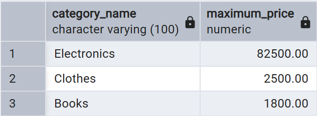

### Запрос 2. Самый дорогой заказ каждого клиента

```sql
SELECT
    cl.client_id,
    cl.first_name,
    cl.surname,
    MAX(o.order_total) AS maximum_order_total
FROM client AS cl
JOIN orders AS o
    ON o.client_id = cl.client_id
GROUP BY cl.client_id, cl.first_name, cl.surname
ORDER BY maximum_order_total DESC, cl.surname, cl.first_name;
```

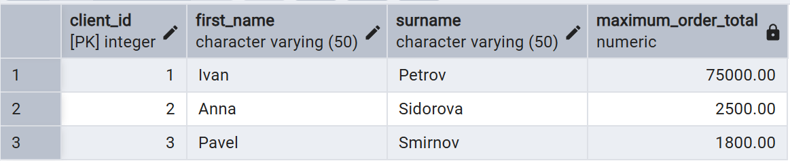

---

## 6. STRING_AGG()

### Запрос 1. Список товаров в каждой категории

```sql
SELECT
    c.category_name,
    STRING_AGG(p.product_name, ', ' ORDER BY p.product_name) AS products
FROM category AS c
JOIN product AS p
    ON p.category_id = c.category_id
GROUP BY c.category_id, c.category_name
ORDER BY c.category_name;
```

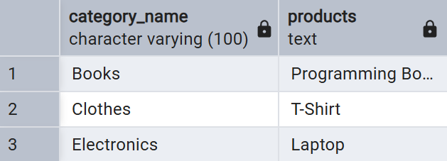

### Запрос 2. Список товаров в каждом заказе

```sql
SELECT
    o.order_id,
    STRING_AGG(
        p.product_name || ' (кол-во: ' || op.quantity || ')',
        ', ' ORDER BY p.product_name
    ) AS products
FROM orders AS o
JOIN order_product AS op
    ON op.order_id = o.order_id
JOIN product AS p
    ON p.product_id = op.product_id
GROUP BY o.order_id
ORDER BY o.order_id;
```

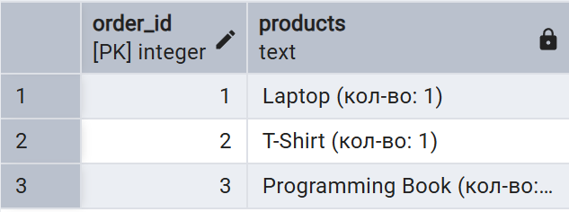

---

## 7. GROUP BY и HAVING

### Запрос 1. Категории, в которых меньше двух товаров

```sql
SELECT
    c.category_name,
    COUNT(p.product_id) AS product_count
FROM category AS c
JOIN product AS p
    ON p.category_id = c.category_id
GROUP BY c.category_id, c.category_name
HAVING COUNT(p.product_id) < 2
ORDER BY product_count DESC, c.category_name;
```

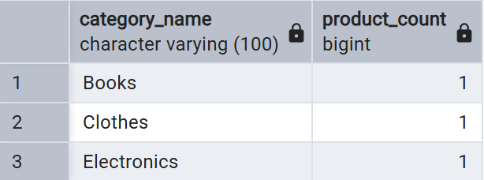

### Запрос 2. Клиенты, потратившие больше средней суммы заказа

```sql
SELECT
    cl.client_id,
    cl.first_name,
    cl.surname,
    SUM(o.order_total) AS total_spent
FROM client AS cl
JOIN orders AS o
    ON o.client_id = cl.client_id
GROUP BY cl.client_id, cl.first_name, cl.surname
HAVING SUM(o.order_total) > (
    SELECT AVG(order_total)
    FROM orders
)
ORDER BY total_spent DESC;
```


---

## 8. GROUPING SETS

### Запрос 1. Продажи по категории, по бренду и общий итог

```sql
SELECT
    c.category_name,
    p.brand,
    SUM(op.quantity * p.price) AS total_sales
FROM order_product AS op
JOIN product AS p
    ON p.product_id = op.product_id
JOIN category AS c
    ON c.category_id = p.category_id
GROUP BY GROUPING SETS (
    (c.category_name, p.brand),
    (c.category_name),
    (p.brand),
    ()
)
ORDER BY c.category_name NULLS LAST, p.brand NULLS LAST;
```

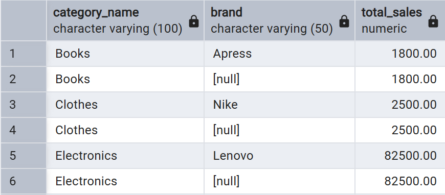

### Запрос 2. Количество заказов по статусу, клиенту и общий итог

```sql
SELECT
    o.status,
    cl.client_id,
    COUNT(o.order_id) AS order_count
FROM orders AS o
JOIN client AS cl
    ON cl.client_id = o.client_id
GROUP BY GROUPING SETS (
    (o.status, cl.client_id),
    (o.status),
    (cl.client_id),
    ()
)
ORDER BY o.status NULLS LAST, cl.client_id NULLS LAST;
```

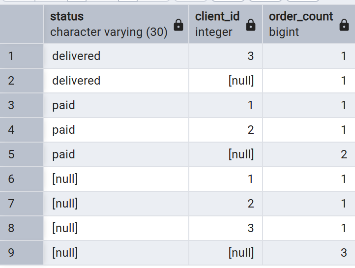

---

## 9. ROLLUP

### Запрос 1. Продажи по категории, бренду и промежуточные итоги

```sql
SELECT
    c.category_name,
    p.brand,
    SUM(op.quantity * p.price) AS total_sales
FROM order_product AS op
JOIN product AS p
    ON p.product_id = op.product_id
JOIN category AS c
    ON c.category_id = p.category_id
GROUP BY ROLLUP (c.category_name, p.brand)
ORDER BY c.category_name NULLS LAST, p.brand NULLS LAST;
```

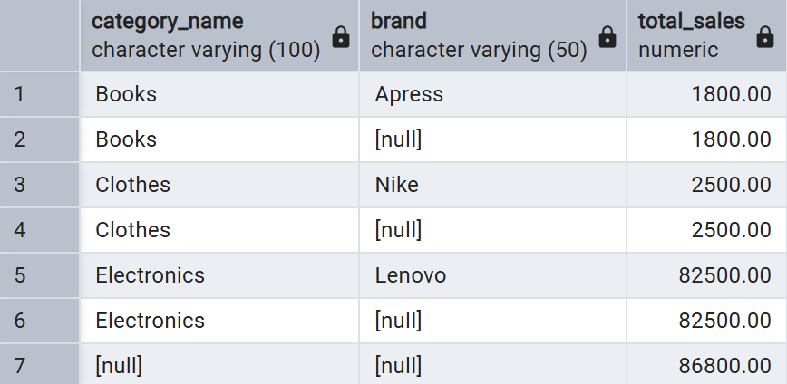

### Запрос 2. Заказы по статусу и дате с итогами по статусу

```sql
SELECT
    o.status,
    o.order_date,
    COUNT(o.order_id) AS order_count,
    SUM(o.order_total) AS total_amount
FROM orders AS o
GROUP BY ROLLUP (o.status, o.order_date)
ORDER BY o.status NULLS LAST, o.order_date NULLS LAST;
```

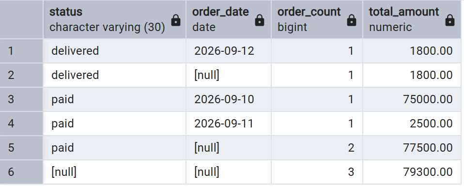

---

## 10. CUBE

### Запрос 1. Продажи по всем комбинациям категории и бренда

```sql
SELECT
    c.category_name,
    p.brand,
    SUM(op.quantity * p.price) AS total_sales
FROM order_product AS op
JOIN product AS p
    ON p.product_id = op.product_id
JOIN category AS c
    ON c.category_id = p.category_id
GROUP BY CUBE (c.category_name, p.brand)
ORDER BY c.category_name NULLS LAST, p.brand NULLS LAST;
```

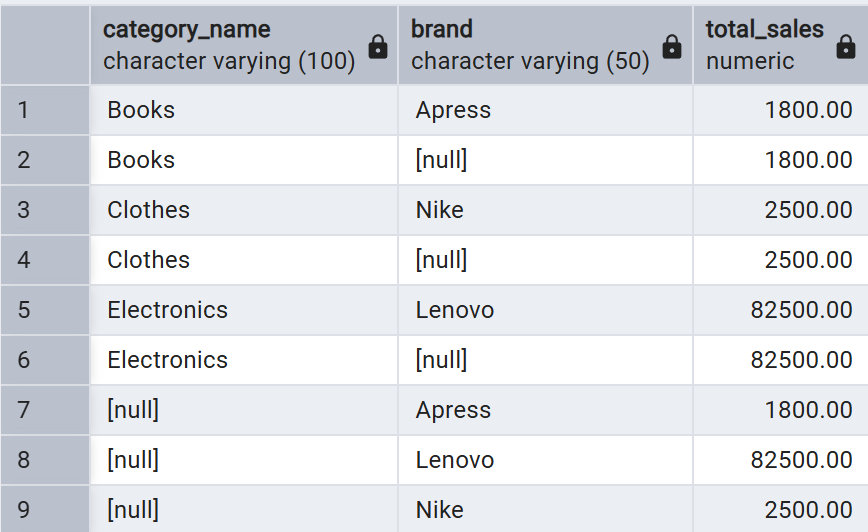

### Запрос 2. Заказы по всем комбинациям статуса и способа оплаты

```sql
SELECT
    o.status,
    pay.payment_method,
    COUNT(DISTINCT o.order_id) AS order_count,
    SUM(pay.payment_amount) AS total_paid
FROM orders AS o
JOIN payment AS pay
    ON pay.order_id = o.order_id
GROUP BY CUBE (o.status, pay.payment_method)
ORDER BY o.status NULLS LAST, pay.payment_method NULLS LAST;
```

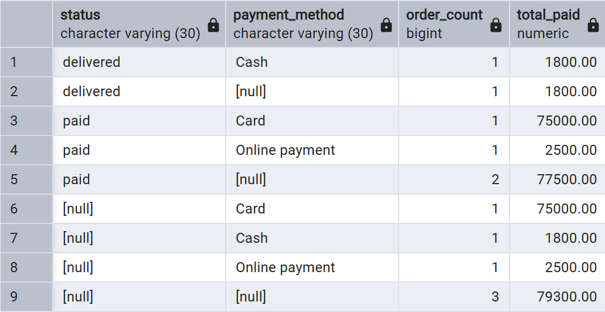

---

## 11. SELECT, FROM, WHERE, GROUP BY, HAVING, ORDER BY

### Запрос 1. Товары дороже 1000 рублей с группировкой по бренду

```sql
SELECT
    p.brand,
    COUNT(p.product_id) AS product_count,
    ROUND(AVG(p.price), 2) AS average_price
FROM product AS p
WHERE p.price > 1000
GROUP BY p.brand
HAVING COUNT(p.product_id) >= 1
ORDER BY average_price DESC, p.brand;
```

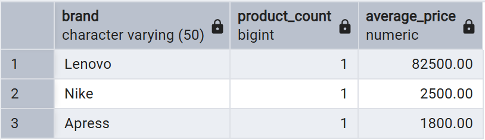

### Запрос 2. Клиенты с заказами на сумму от 5000 рублей

```sql
SELECT
    cl.client_id,
    cl.first_name,
    cl.surname,
    COUNT(o.order_id) AS order_count,
    SUM(o.order_total) AS total_spent
FROM client AS cl
JOIN orders AS o
    ON o.client_id = cl.client_id
WHERE o.order_total > 0
GROUP BY cl.client_id, cl.first_name, cl.surname
HAVING SUM(o.order_total) >= 5000
ORDER BY total_spent DESC, cl.surname, cl.first_name;
```

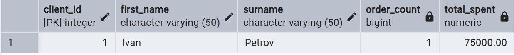
