# HW6. Подзапросы

## 1. Подзапросы в SELECT

### Запрос 1. Количество товаров и средняя цена

```sql
SELECT
    (SELECT COUNT(*) FROM product) AS product_count,
    (SELECT ROUND(AVG(price), 2) FROM product) AS average_price;
```

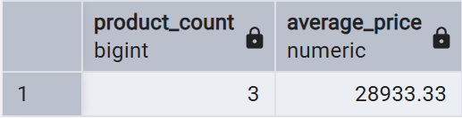

### Запрос 2. Количество клиентов и заказов

```sql
SELECT
    (SELECT COUNT(*) FROM client) AS client_count,
    (SELECT COUNT(*) FROM orders) AS order_count;
```


---

## 2. Подзапросы в FROM

### Запрос 1. Клиенты, потратившие больше 5000

```sql
SELECT
    client_id,
    total_spent
FROM (
    SELECT
        client_id,
        SUM(order_total) AS total_spent
    FROM orders
    GROUP BY client_id
) AS client_totals
WHERE total_spent > 5000
ORDER BY total_spent DESC;
```

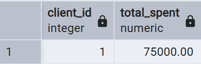

### Запрос 2. Категории со средней ценой выше средней цены всех товаров

```sql
SELECT
    category_id,
    average_price
FROM (
    SELECT
        category_id,
        ROUND(AVG(price), 2) AS average_price
    FROM product
    GROUP BY category_id
) AS category_prices
WHERE average_price > (
    SELECT AVG(price)
    FROM product
)
ORDER BY average_price DESC;
```

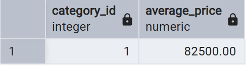

---

## 3. Подзапросы в WHERE

### Запрос 1. Товары дороже средней цены

```sql
SELECT
    product_id,
    product_name,
    price
FROM product
WHERE price > (
    SELECT AVG(price)
    FROM product
)
ORDER BY price DESC;
```

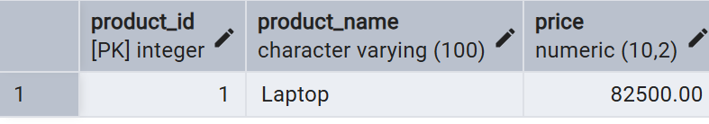

### Запрос 2. Заказы дороже среднего заказа

```sql
SELECT
    order_id,
    order_date,
    order_total,
    client_id
FROM orders
WHERE order_total > (
    SELECT AVG(order_total)
    FROM orders
)
ORDER BY order_total DESC;
```

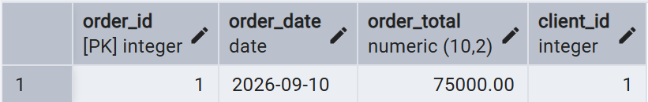

---

## 4. Подзапросы в HAVING

### Запрос 1. Клиенты, потратившие больше средней суммы по клиентам

```sql
SELECT
    client_id,
    SUM(order_total) AS total_spent
FROM orders
GROUP BY client_id
HAVING SUM(order_total) > (
    SELECT AVG(total_spent)
    FROM (
        SELECT SUM(order_total) AS total_spent
        FROM orders
        GROUP BY client_id
    ) AS client_totals
)
ORDER BY total_spent DESC;
```

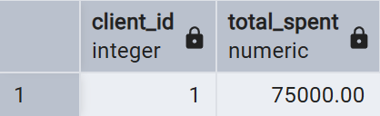

### Запрос 2. Категории, в которых товаров больше среднего или равно среднему

```sql
SELECT
    category_id,
    COUNT(*) AS product_count
FROM product
GROUP BY category_id
HAVING COUNT(*) >= (
    SELECT AVG(product_count)
    FROM (
        SELECT COUNT(*) AS product_count
        FROM product
        GROUP BY category_id
    ) AS category_counts
)
ORDER BY product_count DESC;
```

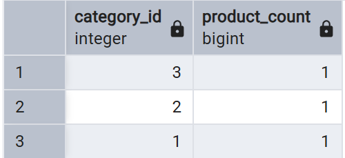

---

## 5. Оператор ALL

### Запрос 1. Товары дешевле всех товаров дороже 1000

```sql
SELECT
    product_id,
    product_name,
    price
FROM product
WHERE price < ALL (
    SELECT price
    FROM product
    WHERE price > 10000
)
ORDER BY price;
```

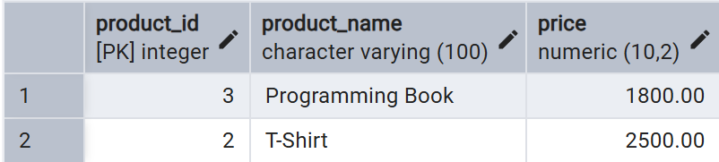

### Запрос 2. Клиенты, у которых все заказы дешевле 10000

```sql
SELECT
    c.client_id,
    c.first_name,
    c.surname
FROM client AS c
WHERE 10000 > ALL (
    SELECT o.order_total
    FROM orders AS o
    WHERE o.client_id = c.client_id
)
ORDER BY c.surname, c.first_name;
```

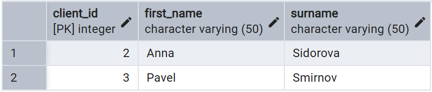

---

## 6. Оператор IN

### Запрос 1. Клиенты, у которых есть заказы со статусом `completed`

```sql
SELECT
    client_id,
    first_name,
    surname
FROM client
WHERE client_id IN (
    SELECT client_id
    FROM orders
    WHERE status = 'paid'
)
ORDER BY surname, first_name;
```

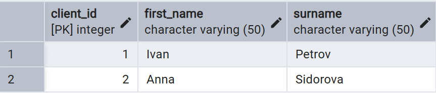

### Запрос 2. Товары из категорий, в которых цена выше 1000

```sql
SELECT
    product_id,
    product_name,
    category_id
FROM product
WHERE category_id IN (
    SELECT category_id
    FROM product
    GROUP BY category_id
    HAVING MAX(price) > 1000
)
ORDER BY category_id, product_name;
```

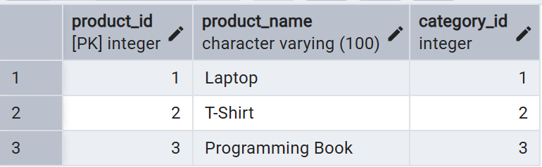

---

## 7. Оператор ANY

### Запрос 1. Товары дороже хотя бы одного товара категории 2

```sql
SELECT
    product_id,
    product_name,
    price
FROM product
WHERE price > ANY (
    SELECT price
    FROM product
    WHERE category_id = 2
)
ORDER BY price DESC;
```

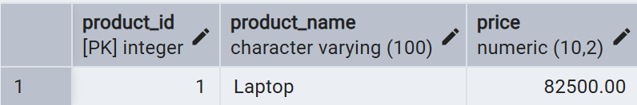

### Запрос 2. Заказы дороже хотя бы одного заказа клиента 1

```sql
SELECT
    order_id,
    client_id,
    order_total
FROM orders
WHERE order_total > ANY (
    SELECT order_total
    FROM orders
    WHERE client_id = 1
)
ORDER BY order_total DESC;
```

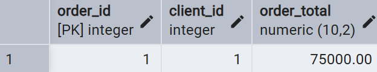

---

## 8. EXISTS и NOT EXISTS

### Запрос 1. Клиенты, у которых есть хотя бы один заказ

```sql
SELECT
    c.client_id,
    c.first_name,
    c.surname
FROM client AS c
WHERE EXISTS (
    SELECT 1
    FROM orders AS o
    WHERE o.client_id = c.client_id
)
ORDER BY c.surname, c.first_name;
```

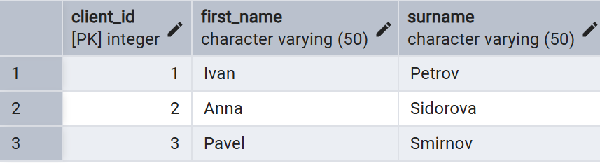

### Запрос 2. Товары, которые заказывали хоть раз

```sql
SELECT
    p.product_id,
    p.product_name
FROM product AS p
WHERE EXISTS (
    SELECT 1
    FROM order_product AS op
    WHERE op.product_id = p.product_id
)
ORDER BY p.product_name;
```

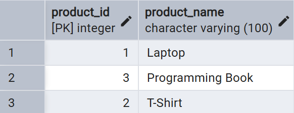

---

## 9. Сравнение по нескольким столбцам

### Запрос 1. Товары, которые встречаются в заказах с указанным количеством

```sql
SELECT
    p.product_id,
    p.product_name,
    p.price
FROM product AS p
WHERE (p.product_id, p.price) IN (
    SELECT
        op.product_id,
        pr.price
    FROM order_product AS op
    JOIN product AS pr
        ON pr.product_id = op.product_id
)
ORDER BY p.product_id;
```

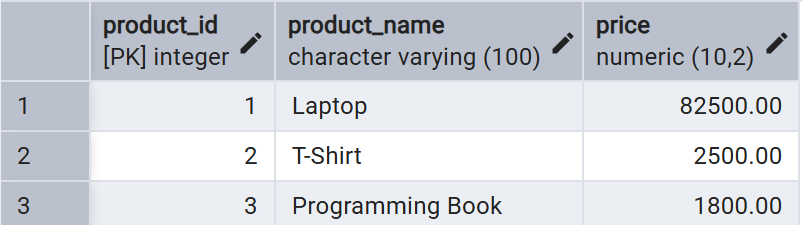

### Запрос 2. Заказы, у которых сумма совпадает с платежом

```sql
SELECT
    o.order_id,
    o.order_total,
    p.payment_amount
FROM orders AS o
JOIN payment AS p
    ON p.order_id = o.order_id
WHERE (o.order_id, o.order_total) IN (
    SELECT
        order_id,
        payment_amount
    FROM payment
)
ORDER BY o.order_id;
```

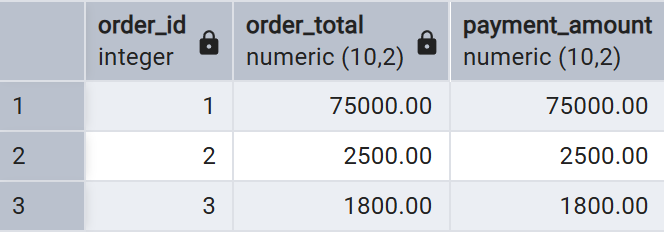

---

## 10. Коррелированные подзапросы

### Запрос 1. Количество заказов каждого клиента

```sql
SELECT
    c.client_id,
    c.first_name,
    c.surname,
    (
        SELECT COUNT(*)
        FROM orders AS o
        WHERE o.client_id = c.client_id
    ) AS order_count
FROM client AS c
ORDER BY order_count DESC, c.surname, c.first_name;
```

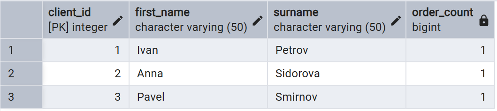

### Запрос 2. Общая сумма заказов каждого клиента

```sql
SELECT
    c.client_id,
    c.first_name,
    c.surname,
    COALESCE((
        SELECT SUM(o.order_total)
        FROM orders AS o
        WHERE o.client_id = c.client_id
    ), 0) AS total_spent
FROM client AS c
ORDER BY total_spent DESC, c.surname, c.first_name;
```

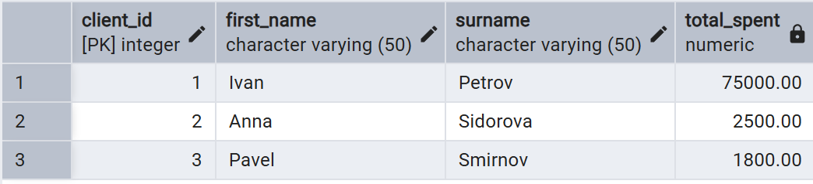

### Запрос 3. Товары, которые заказывали хотя бы 1 раз

```sql
SELECT
    p.product_id,
    p.product_name
FROM product AS p
WHERE (
    SELECT COUNT(*)
    FROM order_product AS op
    WHERE op.product_id = p.product_id
) > 1
ORDER BY p.product_name;
```

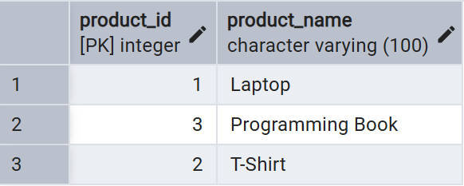

### Запрос 4. Заказы выше среднего или равного заказа своего клиента

```sql
SELECT
    o.order_id,
    o.client_id,
    o.order_total
FROM orders AS o
WHERE o.order_total >= (
    SELECT AVG(o2.order_total)
    FROM orders AS o2
    WHERE o2.client_id = o.client_id
)
ORDER BY o.client_id, o.order_total DESC;
```

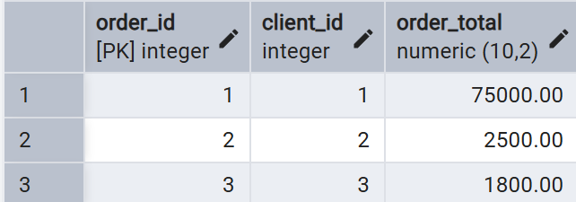

### Запрос 5. Товары дороже или равны средней цене своей категории

```sql
SELECT
    p.product_id,
    p.product_name,
    p.category_id,
    p.price
FROM product AS p
WHERE p.price >= (
    SELECT AVG(p2.price)
    FROM product AS p2
    WHERE p2.category_id = p.category_id
)
ORDER BY p.category_id, p.price DESC;
```

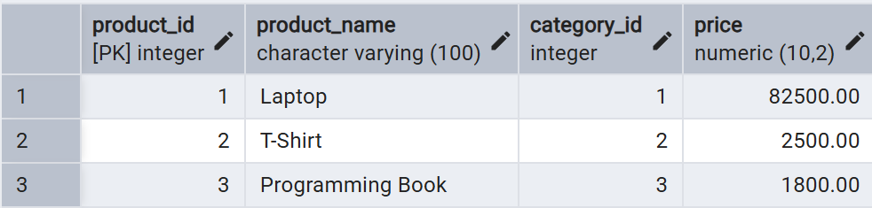

