# HW7. CTE и оконные функции

## 1. CTE (`WITH`) — 3 запроса

### Запрос 1. Сумма заказов по клиентам

```sql
WITH client_totals AS (
    SELECT
        client_id,
        COUNT(*) AS order_count,
        SUM(order_total) AS total_spent
    FROM orders
    GROUP BY client_id
)
SELECT
    c.client_id,
    c.first_name,
    c.surname,
    ct.order_count,
    ct.total_spent
FROM client AS c
JOIN client_totals AS ct
    ON ct.client_id = c.client_id
ORDER BY ct.total_spent DESC;
```

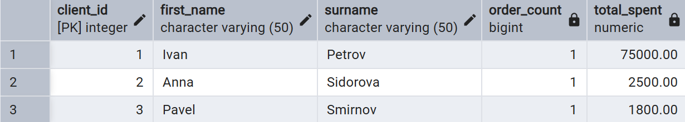

### Запрос 2. Продажи по категориям

```sql
WITH category_sales AS (
    SELECT
        p.category_id,
        SUM(op.quantity * p.price) AS total_sales
    FROM product AS p
    JOIN order_product AS op
        ON op.product_id = p.product_id
    GROUP BY p.category_id
)
SELECT
    c.category_name,
    cs.total_sales
FROM category AS c
JOIN category_sales AS cs
    ON cs.category_id = c.category_id
ORDER BY cs.total_sales DESC;
```

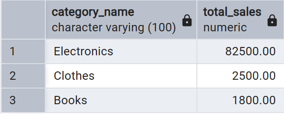

### Запрос 3. Товары с количеством заказов

```sql
WITH product_orders AS (
    SELECT
        product_id,
        COUNT(DISTINCT order_id) AS order_count,
        SUM(quantity) AS units_sold
    FROM order_product
    GROUP BY product_id
)
SELECT
    p.product_id,
    p.product_name,
    COALESCE(po.order_count, 0) AS order_count,
    COALESCE(po.units_sold, 0) AS units_sold
FROM product AS p
LEFT JOIN product_orders AS po
    ON po.product_id = p.product_id
ORDER BY units_sold DESC, p.product_name;
```

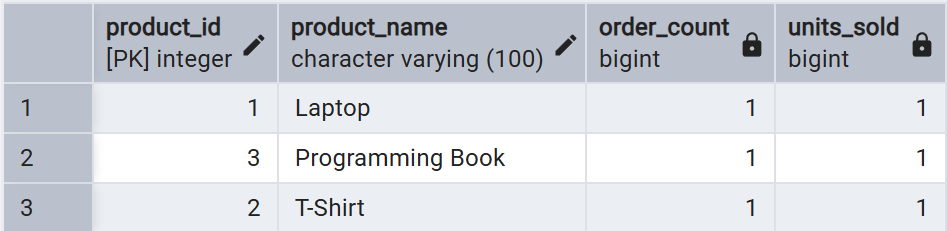

---

## 2. UNION

### Запрос 4. Объединение имён клиентов и названий категорий

```sql
SELECT
    first_name || ' ' || surname AS item_name,
    'client' AS item_type
FROM client
UNION
SELECT
    category_name AS item_name,
    'category' AS item_type
FROM category
ORDER BY item_type, item_name;
```

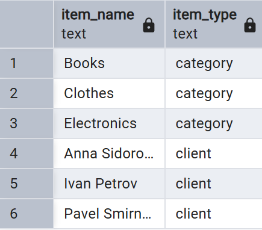

---

## 3. INTERSECT

### Запрос 5. Бренды товаров из категорий 1 и 2

```sql
SELECT brand
FROM product
WHERE category_id = 1
  AND brand IS NOT NULL
INTERSECT
SELECT brand
FROM product
WHERE category_id = 2
  AND brand IS NOT NULL
ORDER BY brand;
```


---

## 4. EXCEPT

### Запрос 6. Клиенты, у которых нет оплаченных заказов

```sql
SELECT client_id
FROM orders
EXCEPT
SELECT o.client_id
FROM orders AS o
JOIN payment AS p
    ON p.order_id = o.order_id
WHERE LOWER(p.payment_status) = 'paid'
ORDER BY client_id;
```

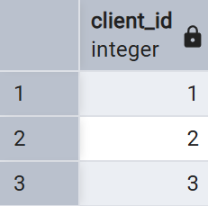

---

## 5. PARTITION BY — 2 запроса

### Запрос 7. Средняя цена в каждой категории

```sql
SELECT
    p.product_id,
    p.product_name,
    p.category_id,
    p.price,
    ROUND(AVG(p.price) OVER (
        PARTITION BY p.category_id
    ), 2) AS category_average_price
FROM product AS p
ORDER BY p.category_id, p.price DESC;
```

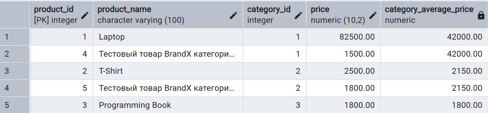

### Запрос 8. Сумма и количество заказов каждого клиента

```sql
SELECT
    o.order_id,
    o.client_id,
    o.order_total,
    COUNT(*) OVER (PARTITION BY o.client_id) AS client_order_count,
    SUM(o.order_total) OVER (PARTITION BY o.client_id) AS client_total_spent
FROM orders AS o
ORDER BY o.client_id, o.order_date;
```

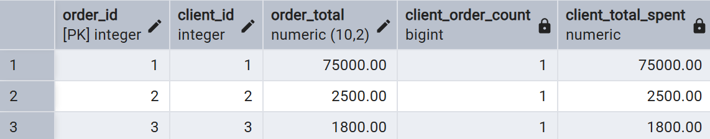

---

## 6. PARTITION BY и ORDER BY — 2 запроса

### Запрос 9. Накопительная сумма заказов клиента

```sql
SELECT
    o.order_id,
    o.client_id,
    o.order_date,
    o.order_total,
    SUM(o.order_total) OVER (
        PARTITION BY o.client_id
        ORDER BY o.order_date, o.order_id
    ) AS running_client_total
FROM orders AS o
ORDER BY o.client_id, o.order_date, o.order_id;
```

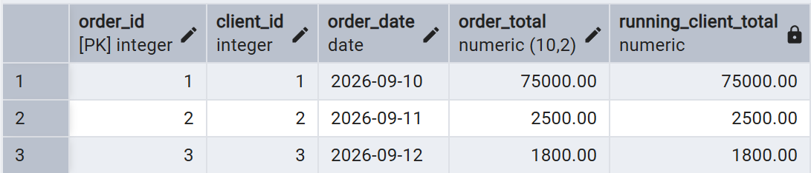

### Запрос 10. Доля заказа в общей сумме клиента

```sql
SELECT
    o.order_id,
    o.client_id,
    o.order_total,
    ROUND(
        100 * o.order_total
        / NULLIF(SUM(o.order_total) OVER (PARTITION BY o.client_id), 0),
        2
    ) AS percent_of_client_total
FROM orders AS o
ORDER BY o.client_id, o.order_total DESC;
```

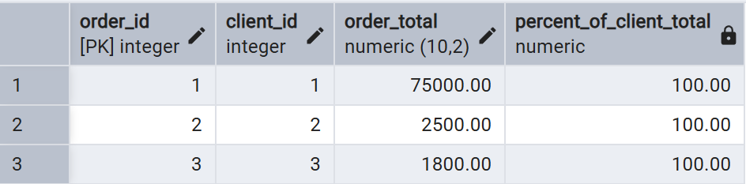

---

## 7. ROWS — 2 запроса

### Запрос 11. Сумма текущего и двух предыдущих заказов

```sql
SELECT
    o.order_id,
    o.client_id,
    o.order_date,
    o.order_total,
    SUM(o.order_total) OVER (
        PARTITION BY o.client_id
        ORDER BY o.order_date, o.order_id
        ROWS BETWEEN 2 PRECEDING AND CURRENT ROW
    ) AS three_order_sum
FROM orders AS o
ORDER BY o.client_id, o.order_date, o.order_id;
```

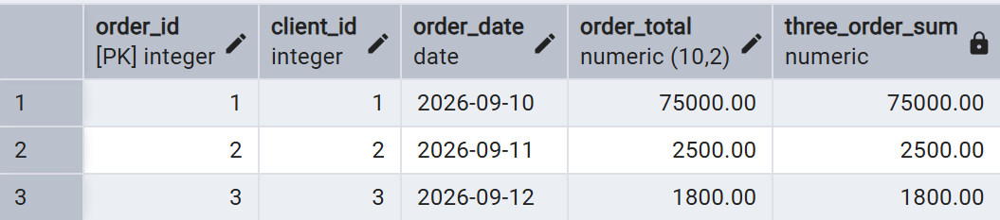

### Запрос 12. Среднее текущего и предыдущего заказа

```sql
SELECT
    o.order_id,
    o.client_id,
    o.order_date,
    o.order_total,
    ROUND(AVG(o.order_total) OVER (
        PARTITION BY o.client_id
        ORDER BY o.order_date, o.order_id
        ROWS BETWEEN 1 PRECEDING AND CURRENT ROW
    ), 2) AS two_order_average
FROM orders AS o
ORDER BY o.client_id, o.order_date, o.order_id;
```

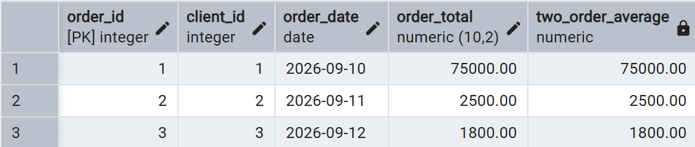

---

## 8. RANGE — 2 запроса

### Запрос 13. Сумма заказов в пределах 30 дней

```sql
SELECT
    o.order_id,
    o.client_id,
    o.order_date,
    o.order_total,
    SUM(o.order_total) OVER (
        PARTITION BY o.client_id
        ORDER BY o.order_date
        RANGE BETWEEN INTERVAL '30 days' PRECEDING AND CURRENT ROW
    ) AS thirty_day_total
FROM orders AS o
ORDER BY o.client_id, o.order_date;
```

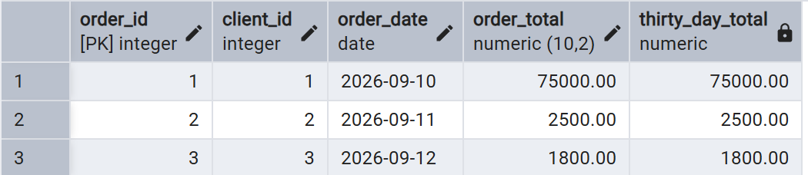

### Запрос 14. Количество заказов на ту же дату и за 7 дней до неё

```sql
SELECT
    o.order_id,
    o.client_id,
    o.order_date,
    COUNT(*) OVER (
        PARTITION BY o.client_id
        ORDER BY o.order_date
        RANGE BETWEEN INTERVAL '7 days' PRECEDING AND CURRENT ROW
    ) AS seven_day_order_count
FROM orders AS o
ORDER BY o.client_id, o.order_date;
```

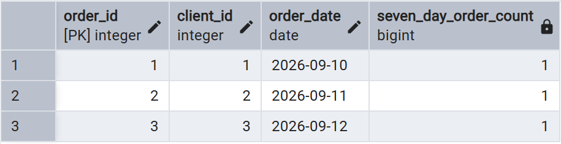

---

## 9. Ранжирующие оконные функции

### Запрос 15. Нумерация товаров по убыванию цены (`ROW_NUMBER`)

```sql
SELECT
    p.product_id,
    p.product_name,
    p.price,
    ROW_NUMBER() OVER (ORDER BY p.price DESC, p.product_id) AS row_number
FROM product AS p
ORDER BY row_number;
```

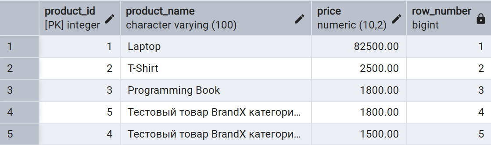

### Запрос 16. Ранг товаров по цене с пропусками при одинаковых значениях (`RANK`)

```sql
SELECT
    p.product_id,
    p.product_name,
    p.price,
    RANK() OVER (ORDER BY p.price DESC) AS price_rank
FROM product AS p
ORDER BY price_rank, p.product_id;
```

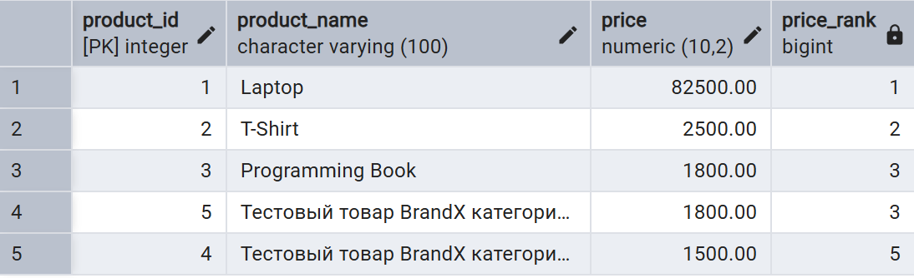

### Запрос 17. Плотный ранг товаров по цене без пропусков (`DENSE_RANK`)

```sql
SELECT
    p.product_id,
    p.product_name,
    p.price,
    DENSE_RANK() OVER (ORDER BY p.price DESC) AS dense_price_rank
FROM product AS p
ORDER BY dense_price_rank, p.product_id;
```

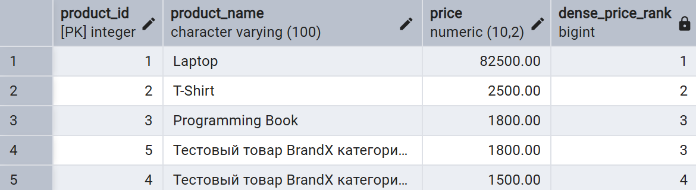

### Запрос 18. Распределение товаров по четырём ценовым группам (`NTILE`)

```sql
SELECT
    p.product_id,
    p.product_name,
    p.price,
    NTILE(4) OVER (ORDER BY p.price DESC) AS price_quartile
FROM product AS p
ORDER BY price_quartile, p.price DESC;
```

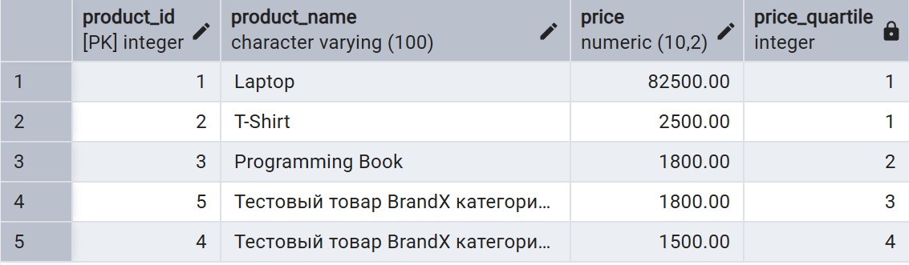

### Запрос 19. Относительный процентный ранг товаров (`PERCENT_RANK`)

```sql
SELECT
    p.product_id,
    p.product_name,
    p.price,
    ROUND((PERCENT_RANK() OVER (ORDER BY p.price DESC))::numeric, 4)
        AS percent_rank
FROM product AS p
ORDER BY percent_rank, p.product_id;
```

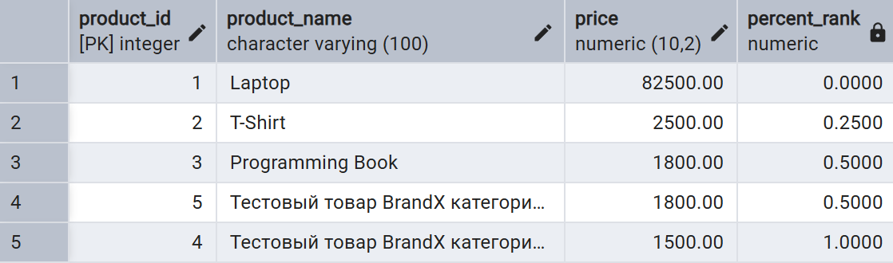

### Запрос 20. Кумулятивное распределение товаров по цене (`CUME_DIST`)

```sql
SELECT
    p.product_id,
    p.product_name,
    p.price,
    ROUND((CUME_DIST() OVER (ORDER BY p.price DESC))::numeric, 4)
        AS cumulative_distribution
FROM product AS p
ORDER BY cumulative_distribution, p.product_id;
```

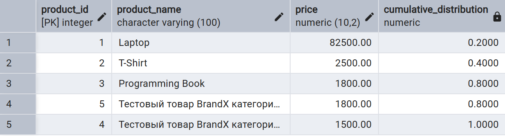

---

## 10. Функции смещения

### Запрос 21. Сравнение заказа с предыдущим заказом клиента (`LAG`)

```sql
SELECT
    o.order_id,
    o.client_id,
    o.order_date,
    o.order_total,
    LAG(o.order_total, 1, 0) OVER (
        PARTITION BY o.client_id
        ORDER BY o.order_date, o.order_id
    ) AS previous_order_total
FROM orders AS o
ORDER BY o.client_id, o.order_date, o.order_id;
```

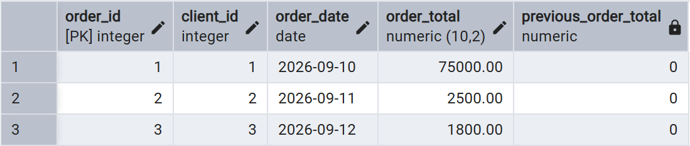

### Запрос 22. Сравнение заказа со следующим заказом клиента (`LEAD`)

```sql
SELECT
    o.order_id,
    o.client_id,
    o.order_date,
    o.order_total,
    LEAD(o.order_total, 1, 0) OVER (
        PARTITION BY o.client_id
        ORDER BY o.order_date, o.order_id
    ) AS next_order_total
FROM orders AS o
ORDER BY o.client_id, o.order_date, o.order_id;
```

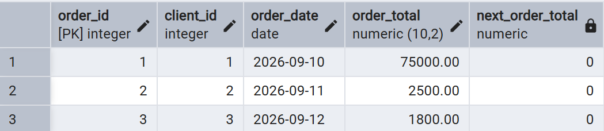

### Запрос 23. Первый заказ каждого клиента (`FIRST_VALUE`)

```sql
SELECT
    o.order_id,
    o.client_id,
    o.order_date,
    o.order_total,
    FIRST_VALUE(o.order_total) OVER (
        PARTITION BY o.client_id
        ORDER BY o.order_date, o.order_id
    ) AS first_client_order_total
FROM orders AS o
ORDER BY o.client_id, o.order_date, o.order_id;
```

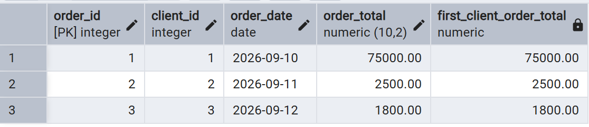

### Запрос 24. Последний заказ каждого клиента (`LAST_VALUE`)

```sql
SELECT
    o.order_id,
    o.client_id,
    o.order_date,
    o.order_total,
    LAST_VALUE(o.order_total) OVER (
        PARTITION BY o.client_id
        ORDER BY o.order_date, o.order_id
        ROWS BETWEEN UNBOUNDED PRECEDING AND UNBOUNDED FOLLOWING
    ) AS last_client_order_total
FROM orders AS o
ORDER BY o.client_id, o.order_date, o.order_id;
```

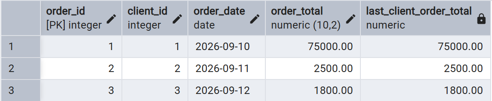

